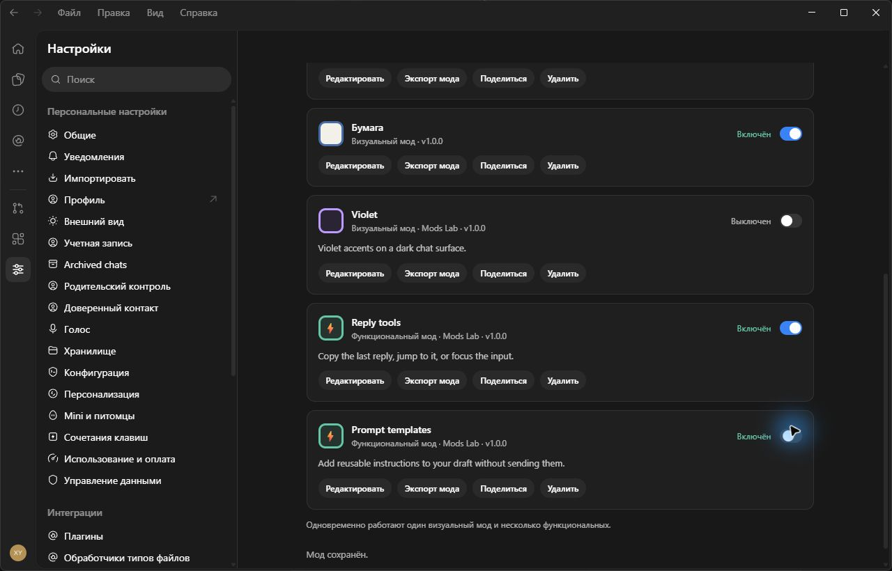
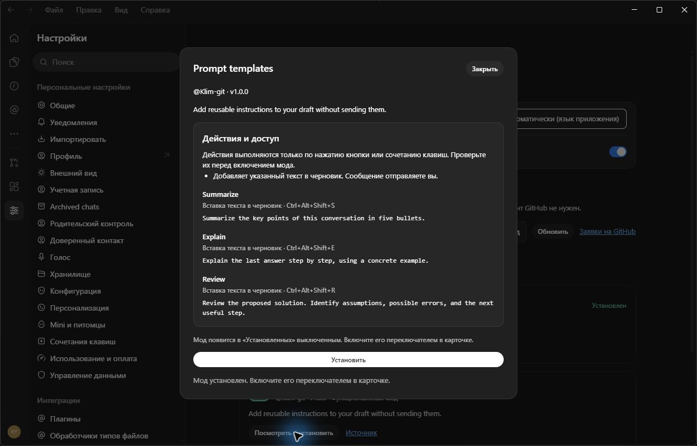
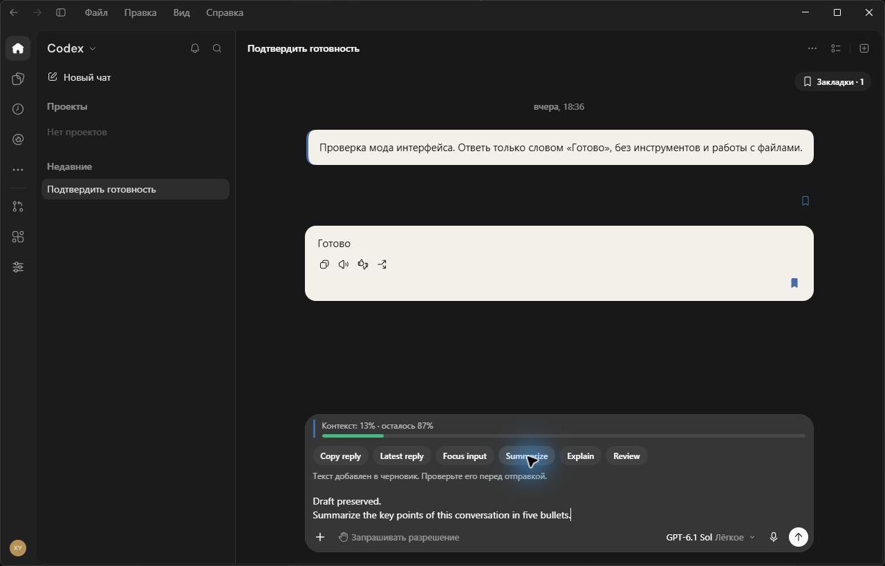

# Codex Mods Lab

[Русский](README.ru.md)

An unofficial UI patch for the Windows Codex desktop app. Adds a **Mods** tab directly to Settings, a shortcut on the left navigation rail, and compact cards with expandable settings for each mod.

The repository contains our patch sources and build tools. You supply your own installed application; the builder creates a separate local copy. No application binaries, bundled application sources, chats, credentials, or profiles are distributed here. The mod interface supports **English and Russian**.

## Included mods

| Mod | What it does |
| --- | --- |
| Context bar | Shows used and remaining context from the app's native token statistics. Optional warning at 70%, 80%, 90%, or 95%. |
| Message bookmarks | Save, rename, remove, and jump to messages in the current chat. Open the bookmark list with **Ctrl+Alt+K**; choose **Alt+B** or disable the shortcut in Settings. Message icons can be hidden independently. |

The master switch starts **off**. Open Settings → **Mods** and enable it; each card has its own controls and reset button. Preferences and bookmarks are saved locally in the test copy's profile. They do not synchronize between devices.

The local library adds **Installed**, package **import/export**, and per-card settings. Your AI assistant can prepare a portable `.codexmod.json` package; import it after reviewing its appearance or actions. Each custom card offers edit, export, share and remove actions. One visual mod and multiple functional mods can be active together. See [visual mods](docs/VISUAL-MODS.md) and [functional mods](docs/FUNCTIONAL-MODS.md) for the package formats.

## Community library

Open **Settings → Mods → Community library** to search, filter by type, preview and install shared visual or functional mods. The catalog is public on GitHub, so installation needs no account. Packages start disabled in **Installed**; your existing appearance is kept. A validated offline copy remains available if GitHub cannot be reached. Ocean, Paper and Violet are the visual starter packages.

Three functional starter packages add buttons above the chat input:

| Package | Actions |
| --- | --- |
| Reply tools | Copy the last loaded reply, jump to the latest message, or focus the input. |
| Prompt templates | Append Summarize, Explain or Review instructions to the existing draft. You send the message yourself. |
| Chat navigation | Jump to the first or last loaded message. |

Actions run only on a button click or a configured **Ctrl+Alt+Shift+letter** shortcut. Edit button labels, template text and shortcuts from each card. Review the actions and access description before enabling a package. This format accepts fixed declarative actions, not arbitrary JavaScript, shell commands, integrations or automatic message sending.

Use **Share mod** on an installed visual or functional mod to prepare a GitHub submission. The default route opens a ready-to-send issue in your browser; sign in and submit it there. An advanced option sends directly from the dialog using a temporary GitHub token. New submissions appear in the catalog after maintainer review. See [sharing and moderation](docs/COMMUNITY.md).

## Interface language

Open **Settings → Mods → Language** and choose **Automatic (app language)**, **English**, or **Русский**. Automatic is the default: Russian app locales use Russian; all other app locales use English. An explicit choice takes effect immediately and persists after restarting the copy.

This covers the Mods tab, navigation shortcut, cards, context meter, warnings, tooltips, bookmark dialogs, and accessibility labels. The host app keeps its own language setting. Existing preferences and bookmarks are preserved; message text and custom bookmark names are not translated.

To update an existing copy, close it completely, update the repository, and rerun the builder with the same output directory. Its local profile is retained.

## Screenshots

Captured from the separate Windows test copy. The new library views below use Russian; the original context and bookmark examples use English mod labels with Russian host navigation.

### Installed and community mods

Functional cards have independent switches, alongside the active visual theme.



The preview lists actions, shortcuts and exact template text before installation.



Buttons add text to the draft while the context meter and bookmarks remain available.



Custom cards include Edit, Export, Share and Remove. There is no creation button: import a package prepared by your AI assistant, or install one from the community catalog.


Search the public GitHub catalog, review the preview and install without signing in.


Sharing opens a preview and consent dialog, then a prepared GitHub submission. New submissions are reviewed before entering the catalog.


### Mods in Settings

The **Mods** tab and navigation shortcut open a page with a language selector, master switch, and one card per mod. Select **Configure** to expand that mod's settings.


### Context bar

The meter sits above the message input. This example shows **13% used and 87% remaining**, based on the conversation's last native token report. The warning threshold is configurable in the mod's card.


### Message bookmarks

Open the current chat's saved messages from its **Bookmarks** button or with **Ctrl+Alt+K**. Select a bookmark to jump to the message, or use **Rename** and **Remove**.


## Compatibility

This first release supports only the tested Windows build:

- Application version inside `app.asar`: **26.1007.21434**.
- Tested Microsoft Store package: **OpenAI.Codex 26.1007.2314.0 x64**.
- Original `resources/app.asar` SHA-256: `c5fdef328cfa2ad9095786f9c3a7aaa447e68834d31299d6ef2592da02029038`.

The builder checks the archive hash, application version, and every replacement anchor before writing output. It refuses other builds rather than guessing at changed internal bindings. Updating Codex may require a new version of this patch. macOS, Linux, and the web app are not supported.

## Install

Requirements: Windows, an installed compatible Codex app, **Python 3.10+**, and about **3 GB** of free space. No Python dependencies are needed. Node.js 20+ is needed only for development tests.

Download this repository using **Code → Download ZIP**, then extract it, or clone it:

```powershell
git clone https://github.com/Klim-git/codex-mods-lab.git
cd codex-mods-lab
python scripts/build_copy.py
python scripts/verify_copy.py
```

The builder detects your installed Store package and writes the copy into `.mods-lab`. If `python` is unavailable but the Windows Python launcher is installed, use `py -3` instead.

If auto-detection cannot find the installation, specify its **app** directory:

```powershell
python scripts/build_copy.py --source-app "C:\path\to\Codex\app"
```

Start the copy with `.mods-lab\Launch-Mods.cmd`, or from PowerShell:

```powershell
powershell.exe -NoProfile -ExecutionPolicy Bypass -File .mods-lab/Launch-Mods.ps1
```

It opens the Mods tab. Use the launcher: starting the copied executable directly is rejected by the profile isolation guard. The test window has a **Моды (тест)** suffix. Close the test copy before rebuilding it.

Use `--output "D:\CodexModsLab"` for another new directory. Existing folders containing unrelated files and paths overlapping the original installation are rejected. To prepare local patch previews without copying the app, use `--patch-only`; generated application bundles stay in the ignored output directory.

## What isolation means

The original installation is read without being patched. The copied app receives its own `app-data`, `codex-home`, and `logs` directories. The builder does not copy the original user's chats, authentication files, or configuration, and the launcher sets profile environment variables only for its child process. Automatic updates are disabled in the copy.

Local profile separation does not create a separate online account. Signing into the same account can expose the same cloud data, and the application may reuse operating-system authentication. This is an experiment copy, not a security sandbox.

Patching the archive also requires changing its embedded checksum in the copied executable. Archive integrity validation stays enabled, but this change invalidates the copy's original Authenticode signature. The original executable stays unchanged. This project is independent of OpenAI and does not distribute a signed application or installer.

## Limitations

- The context bar reads the last native token-usage report for local Codex conversations, not a cumulative sum of every turn. It is an indication of reported usage, not an exact prediction of when compaction will occur. Other conversation types or missing statistics show an unknown state.
- Live testing covered local Codex chats. ChatGPT bookmark rendering and older-history navigation adapters have automated checks; a live ChatGPT history check remains outstanding.
- Bookmarks belong to a local conversation identity. If the message or conversation is removed, the saved bookmark may no longer be navigable.
- Internal application bindings are version specific. There is no general third-party mod API here.

## Development and verification

```powershell
python -m unittest discover -s tests -p test_builder.py
node tests/run.mjs
```

These checks use authored modules and synthetic archives. They do not need Codex or redistributed application fixtures. Native integration checks additionally need a local preview built with the supported application, using the default output directory:

```powershell
python scripts/build_copy.py --patch-only
$env:CODEX_MODS_INTEGRATION = '1'
node tests/run.mjs
Remove-Item Env:CODEX_MODS_INTEGRATION
```

See [verification notes](docs/TESTING.md) for what was checked. Keep generated copies, profiles, logs, and patched application bundles out of commits; they are covered by `.gitignore`. Before reporting a bug, remove chat content, local paths, and authentication information from any diagnostic material.

## Related work and license

[Codex++](https://github.com/b-nnett/codex-plusplus) has a similar idea of extending the desktop UI and Settings. This is an independent implementation of our Mods tab, context bar, and bookmark workflow; it is not a claim to have invented a mods section.

Our authored patch and tooling are available under the [MIT license](LICENSE). The license does not cover the original Codex application, its assets, or generated copies of its bundles.
