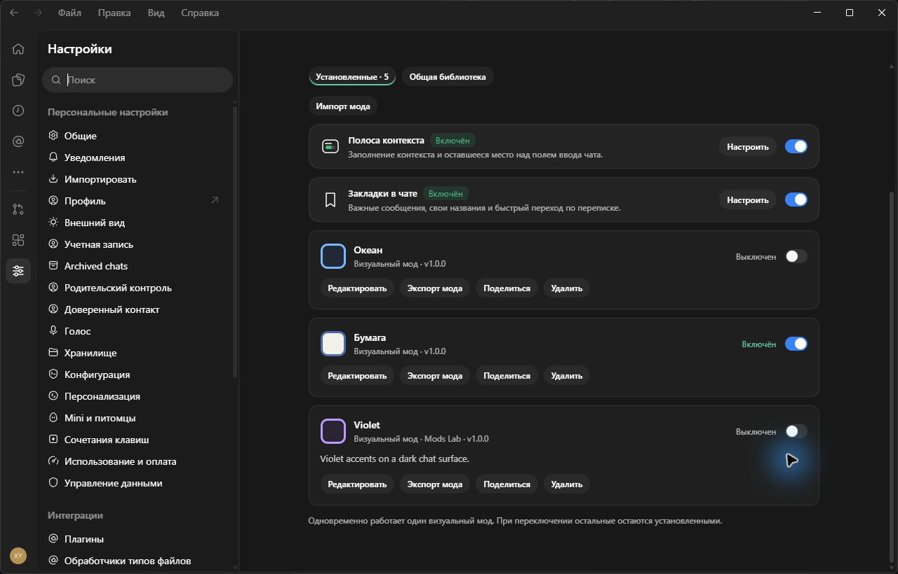
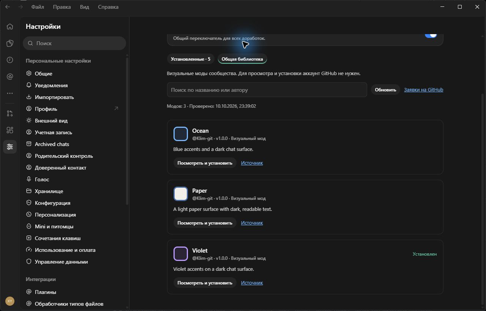
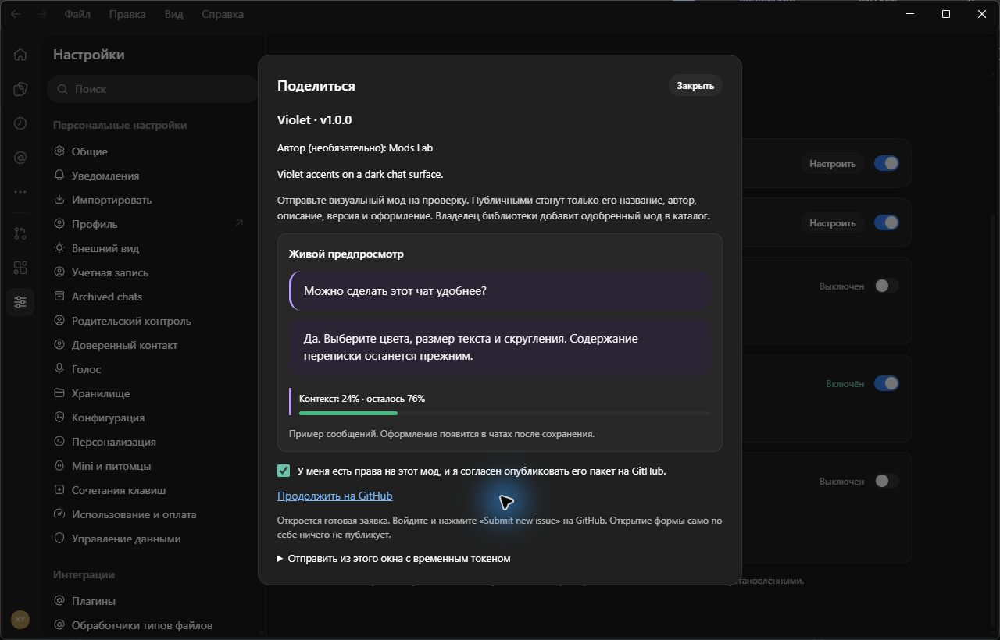

# Codex Mods Lab

[English](README.md)

Неофициальный патч интерфейса Windows-приложения Codex: отдельная вкладка **«Моды»** прямо в настройках, кнопка перехода на левой панели и карточки модов со сворачиваемыми настройками.

Здесь опубликованы наш код и инструменты сборки. Установленное приложение предоставляет сам пользователь; сборщик создаёт его отдельную локальную копию. Бинарники Codex, полные исходные бандлы приложения, чаты, профили и учётные данные в репозиторий не входят. Интерфейс модов поддерживает **русский и английский**.

## Два первых мода

| Мод | Возможности |
| --- | --- |
| Полоса контекста | Показывает использованный и оставшийся контекст по статистике самого приложения. Порог предупреждения: 70%, 80%, 90% или 95%. |
| Закладки сообщений | Добавление, переименование, удаление и переход к сообщениям текущего чата. Список открывается по **Ctrl+Alt+K**; можно выбрать **Alt+B** или отключить сочетание. Значки у сообщений скрываются отдельно. |

Общий переключатель по умолчанию **выключен**. Откройте Настройки → **Моды**, включите моды и настройте нужную карточку. Настройки и закладки сохраняются локально в профиле тестовой копии; синхронизации между устройствами нет.

Добавлена локальная библиотека: **«Установленные»**, **импорт и экспорт** пакетов и **настройки оформления с живым предпросмотром в карточке**. Нейросеть готовит `.codexmod.json`; импортируйте пакет после проверки предпросмотра. В карточке пользовательского мода доступны редактирование, экспорт, публикация и удаление. Одновременно работает один визуальный мод. Первый формат поддерживает параметры оформления; [инструкция и описание формата](docs/VISUAL-MODS.md).

## Общая библиотека

Откройте **Настройки → Моды → Общая библиотека**, чтобы найти, посмотреть и установить визуальные моды сообщества. Публичный каталог хранится на GitHub; для установки аккаунт не нужен. Мод появляется в **«Установленных»** выключенным, текущее оформление сохраняется. Если GitHub недоступен, остаётся последняя проверенная копия каталога. Для начала доступны Ocean, Paper и Violet.

Кнопка **«Поделиться»** в карточке вашего мода подготавливает заявку GitHub. По умолчанию открывается готовая форма в браузере: войдите и отправьте её. Для опытных пользователей есть отправка прямо из окна с временным токеном GitHub. Новые заявки попадают в общий каталог после проверки владельцем. Подробнее: [публикация и проверка](docs/COMMUNITY.md).

## Язык интерфейса

В **Настройки → Моды → Язык** доступны **Автоматически (язык приложения)**, **Русский** и **English**. По умолчанию моды следуют языку приложения: для русской локали — русский, для остальных — английский. Ручной выбор применяется сразу и сохраняется после перезапуска копии.

Перевод охватывает вкладку, кнопку на панели, карточки, полосу контекста, предупреждения, подсказки, окна закладок и подписи для средств доступности. Язык самого приложения настраивается отдельно. Прежние настройки, сообщения и пользовательские названия закладок сохраняются.

Для обновления существующей копии полностью закройте её, обновите репозиторий и повторите сборку с той же папкой вывода. Локальный профиль будет сохранён.

## Скриншоты

Кадры русского интерфейса из отдельной тестовой копии приложения Windows. [Английский вариант](README.md#screenshots) показан в основном README.

### Установленные моды и общая библиотека

В карточках пользовательских модов есть редактирование, экспорт, «Поделиться» и «Удалить». Кнопки создания нет: импортируйте подготовленный нейросетью пакет или установите мод из общего каталога.



Поиск, предпросмотр и установка из публичного каталога GitHub доступны без входа в аккаунт.



Публикация открывает предпросмотр и согласие, затем готовую заявку GitHub. Новые заявки попадают в каталог после проверки.



### Вкладка «Моды» в настройках

Вкладка **«Моды»** и кнопка на левой панели открывают страницу с общим переключателем и отдельной карточкой для каждого мода. Кнопка **«Настроить»** разворачивает настройки выбранного мода.


### Полоса контекста

Полоса расположена над полем ввода. В этом примере **использовано 13%, осталось 87%** — по последней статистике токенов текущего чата. Порог предупреждения выбирается в настройках мода.


### Закладки сообщений

Список сохранённых сообщений текущего чата открывается кнопкой **«Закладки»** или сочетанием **Ctrl+Alt+K**. Нажатие на закладку переносит к сообщению; название можно изменить, а закладку — удалить.


## Совместимость

Поддерживается только проверенная сборка Windows:

- Версия приложения внутри `app.asar`: **26.1007.21434**.
- Проверенный пакет Microsoft Store: **OpenAI.Codex 26.1007.2314.0 x64**.
- SHA-256 исходного `resources/app.asar`: `c5fdef328cfa2ad9095786f9c3a7aaa447e68834d31299d6ef2592da02029038`.

Сборщик проверяет версию, хеш архива и все точки изменения до записи файлов. На другой сборке он останавливается. После обновления Codex может потребоваться обновление патча. macOS, Linux и веб-версия не поддерживаются.

## Установка

Нужны Windows, установленная совместимая версия Codex, **Python 3.10+** и около **3 ГБ** свободного места. Зависимостей Python нет. Node.js 20+ нужен только для тестов разработчика.

Скачайте репозиторий через **Code → Download ZIP** и распакуйте его либо клонируйте:

```powershell
git clone https://github.com/Klim-git/codex-mods-lab.git
cd codex-mods-lab
python scripts/build_copy.py
python scripts/verify_copy.py
```

Сборщик сам находит установленный пакет Store и создаёт копию в `.mods-lab`. Если вместо `python` установлен Windows Python Launcher, используйте `py -3`.

Если автоматический поиск не сработал, укажите папку **app**:

```powershell
python scripts/build_copy.py --source-app "C:\путь\к\Codex\app"
```

Для запуска откройте `.mods-lab\Launch-Mods.cmd` или выполните:

```powershell
powershell.exe -NoProfile -ExecutionPolicy Bypass -File .mods-lab/Launch-Mods.ps1
```

Копия откроется на вкладке «Моды». Используйте лаунчер: прямой запуск скопированного exe блокирует проверка изоляции профиля. У тестового окна есть суффикс **«Моды (тест)»**. Перед повторной сборкой закройте тестовую копию.

Другую новую папку можно задать через `--output "D:\CodexModsLab"`. Папки с посторонними файлами и пути, пересекающиеся с исходной установкой, отклоняются. Ключ `--patch-only` создаёт локальные бандлы для проверки без копирования приложения; они остаются в игнорируемой выходной папке.

## Изоляция и ограничения

Исходная установка читается без изменения. У копии свои папки `app-data`, `codex-home` и `logs`. Исходные чаты, файлы авторизации и конфигурация пользователя не копируются. Переменные профиля задаются только дочернему процессу; автоматические обновления в копии отключены.

Отдельный локальный профиль не создаёт отдельную учётную запись. При входе в тот же аккаунт будут доступны те же облачные данные; приложение также может использовать авторизацию операционной системы. Это тестовая копия, а не защитная песочница.

Изменение архива требует обновления встроенной контрольной суммы в скопированном exe. Проверка целостности архива сохраняется, но исходная подпись Authenticode у копии становится недействительной. Оригинальный exe остаётся неизменным. Проект независим от OpenAI; подписанное приложение или установщик здесь не распространяются.

Полоса контекста использует последнюю штатную статистику локального чата Codex. Это ориентир, а не точный прогноз момента сжатия. Для других типов чатов или при отсутствии статистики отображается неизвестное значение. Закладки локальных чатов проверены в живом интерфейсе; адаптеры ChatGPT и загрузки старой истории проверены автоматически, живую проверку истории ChatGPT ещё предстоит провести. После удаления чата или сообщения переход по сохранённой закладке может стать недоступен.

## Разработка

```powershell
python -m unittest discover -s tests -p test_builder.py
node tests/run.mjs
```

Эти тесты используют наши модули и искусственные архивы, без файлов Codex. Проверки интеграции требуют локальной сборки совместимого приложения в папку по умолчанию:

```powershell
python scripts/build_copy.py --patch-only
$env:CODEX_MODS_INTEGRATION = '1'
node tests/run.mjs
Remove-Item Env:CODEX_MODS_INTEGRATION
```

Список проверок — в [docs/TESTING.md](docs/TESTING.md). Не добавляйте в коммиты копию приложения, профили, логи и сгенерированные бандлы; они исключены через `.gitignore`. Перед публикацией диагностики удалите из неё содержимое чатов, локальные пути и данные авторизации.

## Похожие проекты и лицензия

У [Codex++](https://github.com/b-nnett/codex-plusplus) уже есть похожая идея расширения интерфейса и настроек. Здесь опубликована наша независимая реализация вкладки, полосы контекста и закладок; утверждения «сделано впервые» нет.

Наш код и инструменты — под [лицензией MIT](LICENSE). Она не распространяется на оригинальное приложение Codex, его ресурсы и сгенерированные копии его бандлов.
