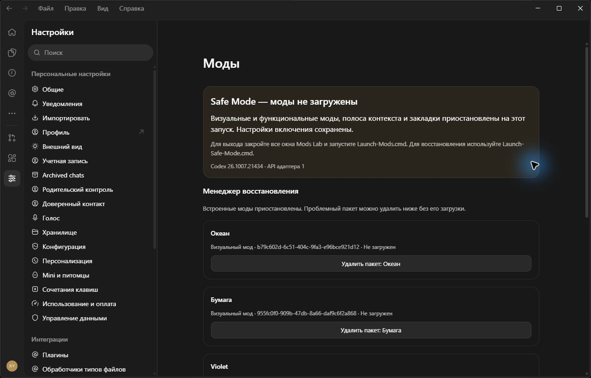
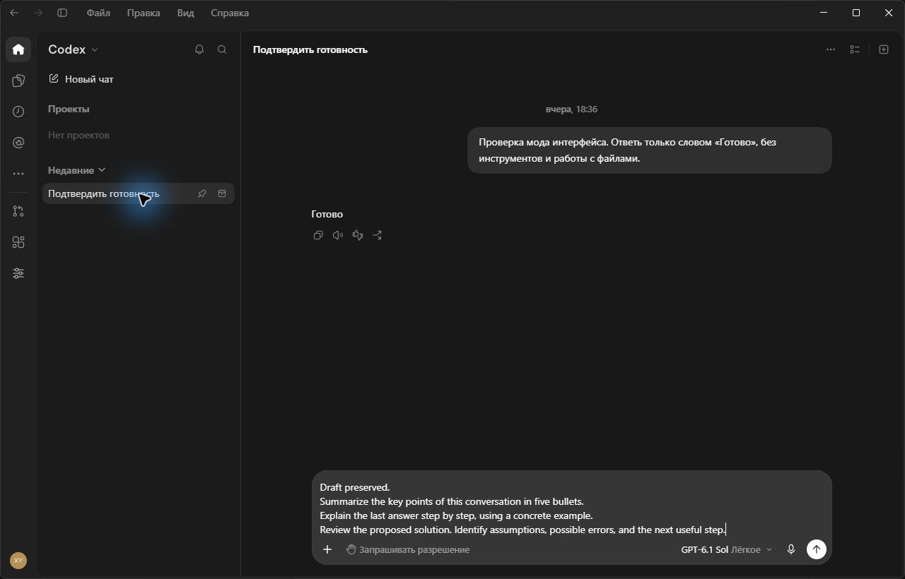

# Safe Mode / Режим восстановления

## English

Close **all Mods Lab windows**, then run `Launch-Safe-Mode.cmd` in the generated copy. The window title includes **Safe Mode**. Alternatively:

```powershell
powershell.exe -NoProfile -ExecutionPolicy Bypass -File .mods-lab/Launch-Mods.ps1 -SafeMode
```

Safe Mode pauses visual packages, functional actions, the context bar and bookmarks for this session. Their enabled settings remain saved. The core skips importing those mod modules; their styles, listeners and startup effects do not run. The native Settings entry and navigation shortcut remain available so you can open **Settings → Mods**.

The recovery manager lists locally installed custom packages as **Not loaded**. Use **Remove package** on the affected card. Removal changes only its library record and associated selection; other packages, global preferences, bookmarks, conversations and account data are retained. **Undo last change** restores the original library while this manager remains open, until the next change. Export a library backup before closing the manager if you need a durable copy.

If a library cannot be read as JSON, individual records cannot be identified. The manager offers export of its original contents and a reset of **that library only**. Export before resetting; Undo has the same temporary lifetime. Changes are rejected if another window has modified that library since it was read.

To return to normal operation, close all copy windows and run `Launch-Mods.cmd`. The launcher refuses to switch modes while the copy is running, preventing an existing normal session from being mistaken for Safe Mode. Your previous enabled choices return, except for a removed package.





Safe Mode is manual recovery, with no automatic crash detection or quarantine. It cannot repair a broken native app or a failure in the recovery core itself. It adds no execution sandbox or general permission system: current functional packages still use the existing declarative actions.

## Русский

Закройте **все окна Mods Lab** и запустите `Launch-Safe-Mode.cmd` в папке собранной копии. В заголовке окна появится **Safe Mode**. В PowerShell можно запустить `Launch-Mods.ps1 -SafeMode`, как в примере выше.

Визуальные и функциональные пакеты, полоса контекста и закладки приостановлены на этот запуск. Настройки включения сохраняются. Ядро пропускает импорт модулей модов, поэтому их стили, обработчики и эффекты запуска не выполняются. Вкладка **Настройки → Моды** и кнопка на левой панели открывают менеджер восстановления.

Найдите проблемную карточку со статусом **«Не загружен»** и нажмите **«Удалить пакет»**. Остальные пакеты, общие настройки, закладки, чаты и данные аккаунта сохраняются. **«Отменить последнее изменение»** возвращает исходную библиотеку, пока открыт этот менеджер, до следующего изменения. Для резервной копии после закрытия используйте экспорт библиотеки.

Если библиотека содержит нечитаемый JSON, определить отдельные записи невозможно. Можно экспортировать исходные данные и сбросить **только эту библиотеку**. Перед сбросом сохраните экспорт. Отмена также доступна временно. Если другое окно успело изменить библиотеку, операция останавливается, чтобы не перезаписать новые данные.

Для обычного запуска закройте все окна копии и используйте `Launch-Mods.cmd`. Переключение режима при работающей копии запрещено. Прежние включённые моды вернутся; удалённый пакет останется удалённым.

Автоматического определения сбоев и карантина пока нет. Safe Mode не исправляет поломку самого приложения или ядра восстановления. Изоляция исполняемого кода и общая система разрешений в эту доработку не входят; функциональные пакеты по-прежнему используют предусмотренные действия.
